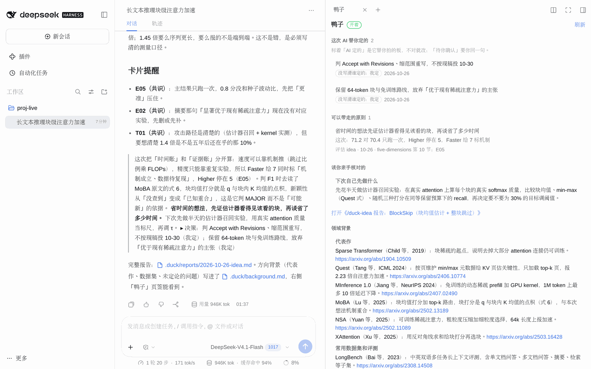

<p align="center">
  <picture>
    <source media="(prefers-color-scheme: dark)" srcset="assets/logo-dark.png">
    
  </picture>
</p>

<h1 align="center">DeepSeek-Ducktor</h1>

<p align="center">
  <em>AI 做研究。Ducktor 讲为什么。道理你带走。</em>
</p>

<p align="center">
  <sub>Trust me, I'm a Ducktor.</sub>
</p>

<p align="center">
  
  
</p>

<p align="center">
  
</p>

<p align="center">
  <strong><a href="https://github.com/JoeyWu-tech/Ducktor">Ducktor</a> 的 DeepSeek Harness 原生插件。</strong><br>
  <strong>贡献怎么定、话说多满、跟谁比，AI 替你定了。Ducktor 把这些判断拆开，一条一条讲给你。</strong><br>
  <strong>Web 界面里，Ducktor 讲到的原则和 AI 替你定的事，摆在对话旁边的「Ducktor」页签里。</strong><br>
  <sub>社区做的插件，不是 DeepSeek 官方出品，和 DeepSeek 公司没有关系。</sub>
</p>

<p align="center">
  <sub>简体中文 &middot; <a href="docs/DETAIL.md">English overview</a></sub>
</p>

---

程序员桌上常有一只黄色的橡皮鸭。程序出了 bug，你把代码一行一行讲给它听，讲着讲着，自己就找到了 bug。

现在 AI 替你做研究，轮不到你讲了。[Ducktor](https://github.com/JoeyWu-tech/Ducktor) 反过来：它把 AI 做过的判断讲给你听。DeepSeek-Ducktor 把它原样装进 DeepSeek Harness：Web 和命令行里都能敲 `/duck-review` 这类命令。规则、命令和卡片是 Ducktor 的原文，和 Claude Code、Codex 用户拿到的是同一份，固定在它的一个提交上（`duck.lock.json` 写着是哪个）。

## 之前 / 之后

你把实验结果交给 AI，让它写成论文。没有 Ducktor，AI 一口气写完。贡献怎么定、话说多满、拿什么比，这些判断都是 AI 做的。它也许在最后提几句，但不拆成道理，不给出处，也不记下来。

装了插件，AI 照样写完。你发 `/duck`，后面直接接问题，比如 `/duck 可不可以告诉我这个内容里我要学什么？`。Ducktor 先说按哪条命令处理，再照那条命令讲；上面动图里，它挑的是复盘（`/duck-learn`）。讲到的原则记进 `.duck/notebook.md`，也出现在「Ducktor」页签里。

## 「Ducktor」页签

<p align="center">
  
</p>

用 agent 做科研时，AI 一路替你做了很多判断，一闪就过去了。Web 界面右侧边栏的「Ducktor」页签把它们摆在对话旁边。打开右侧边栏（右上角的按钮），在「开始」里选「Ducktor」。页签读的是项目 `.duck/` 下的文件：

| 页签里的一块 | 来自 |
|---|---|
| 这次 AI 替你定的 | `decisions.md`；标着「待你确认」的排最前，「AI 定」和「你定」分开标；写成别的（比如「我定」），照原样标「没写清谁定的」 |
| 可以带走的原则 | `notebook.md`；每条带阶段、出处和「这次」 |
| 该你亲手核对的 | `reports/` 里最近一份有核对段落的报告，可以点开整份 |
| 领域背景 | `background.md`；第一次用 `/duck-survey`、`/duck-idea` 摸一个方向时写 |
| 导师会提醒你的 | 最近几步点到的卡片（Ducktor 的 `cards/` 和本插件的 `mentor/cards/`） |
| 报告 | `reports/` 里的报告，可以点开 |

页签开着时每 4 秒看一次文件有没有变，变了就重画。它只读本地文件，不发模型请求。项目里没开 Ducktor 时，页签告诉你怎么开。命令行（TUI、headless）里没有这个页签，`.duck/` 里的文件照样写。Desktop 用的是同一套网页界面，我们没在 Desktop 上测过。

## 道理从哪来

规则要求 Ducktor：讲道理时，名家和出处只从经验卡、名家文章的转述（`cards/MENTORS.md`）和科研手册（`handbook/`）的具体章节里取；找不到出处，就直说这是它自己的判断。

经验卡有两组。Ducktor 带 23 张。这个插件另带 11 张（`mentor/cards/`），讲读论文、进新方向、实验习惯、和导师开会、用 AI 做研究和审稿的规矩。每张写明出处，附原文链接。写卡时对过原文，发布前又让两个独立的模型会话当红队逐条复核过（不是人工审）。

## 安装

需要 DeepSeek Harness 0.2.1-rc.2 及以上、0.3 以下（`package.json` 的 `engines.dsh`，dsh 安装时会检查）。

三种方式任选一种。方式二、方式三都是让 dsh 直接用你放仓库的那个文件夹，不复制（方式一走的是和方式二同一套安装，没单独核对过）：装好以后，这个文件夹别删、别挪，要挪就先卸载，挪完重装。项目里的 `.duck/` 是学生自己的记录，装、卸插件都不会动它。

以前用方式一、二装过这个插件的，先卸载旧的，再更新文件夹（`git pull`，或重新下载解压），最后照下面装。旧 id 是 deepseek-doctor 或 deepseek-supervisor，最早的版本是 deepseek-ducktor。插件页里，旧插件卡片的标题是「DeepSeek-Doctor」，或以「Doctor Duck」开头，点这张卡片上的「卸载」。用命令行卸载时，在每个装过的 profile 里运行 `dsh plugin --profile <名字> remove <旧 id>`。已经更新过文件夹的，也用这条命令按旧 id 卸载。旧 id 是 deepseek-doctor 或 deepseek-supervisor 的，不卸载的话，dsh 会同时加载新旧两个插件。

以前用方式三装过的，不用卸载。更新文件夹以后，把那一行的 id 改成 deepseek-ducktor，文件夹换了位置或名字的话路径也改，`config:` 留着，不用再加一行。

id 从 deepseek-doctor 或 deepseek-supervisor 换过来以后，插件页「配置」里改过的设置不会转到新 id 下。改过设置的，装好以后在「配置」里再改一次。

### 方式一：插件页（Web、Desktop）

1. 把这个仓库放到本机任意位置（`git clone` 或下载解压）。
2. 在 DeepSeek Harness 里打开侧边栏的「插件」，选「安装第三方插件」，在「包名或地址」里填仓库的绝对路径，例如 `/Users/you/DeepSeek-Ducktor`。
3. 装好就生效，不用重启。插件卡片上显示「DeepSeek-Ducktor」。

卸载在同一页面里点「卸载」。npm 装的 dsh 用 PATH 上的 `pnpm` 装插件；Desktop 自带 pnpm。

### 方式二：命令行

```sh
dsh plugin --profile web add /绝对路径/DeepSeek-Ducktor
dsh plugin --profile headless add /绝对路径/DeepSeek-Ducktor
```

每个 profile 单独装，需要 PATH 上有 `pnpm`。装的时候 pnpm 会打一段 `peerDependencies` 的 WARN，说这些包要从 dsh 那边找：插件运行时用的就是 dsh 自带的那几个包，这段警告可以不管。卸载把 `add /绝对路径/DeepSeek-Ducktor` 换成 `remove deepseek-ducktor`。

Desktop 的 profile 名是 `desktop`：先打开一次 Desktop，完全退出，再用 Desktop 自带的 `dsh` 命令（Desktop 菜单「管理 dsh 命令…」可以把它注册到终端）运行 `dsh plugin --profile desktop add /绝对路径/DeepSeek-Ducktor`，然后重新打开 Desktop。

### 方式三：不装 pnpm（命令行）

在 `~/.dsh/cordis.patch.yml`（设了 `DSH_HOME` 就是 `$DSH_HOME/cordis.patch.yml`）里加一行：

```yaml
- insert:
    - id: deepseek-ducktor
      name: /绝对路径/DeepSeek-Ducktor/index.js
```

这一行对所有 profile 生效，下次启动 dsh 时加载。卸载就删掉这一行。

Desktop 用户不要用这种方式：这一行对 Desktop 也生效，会盖过插件页装的那一份，而它在 Desktop 里能不能找到 dsh 自带的包没测过。Desktop 请用方式一。

这一行和方式一、二装上的那一行 id 相同，会盖过它们，不会注册两遍。所以要改设置，也写在这一行里（见「设置」）。

### 装好以后

开一个新会话，在输入框里敲 `/`，能看到全部 14 条命令。方式一装好就生效；方式二、方式三装好以后，先重启一次 dsh（Desktop 要重新打开）。从 `/duck` 开始，它会列出菜单。命令行的 headless 没有输入框，也不用重启：`dsh plugin --profile headless list` 里有 `deepseek-ducktor` 就是装上了，再到项目文件夹里跑 `dsh --profile headless "/duck"`。

刚装好时，Ducktor 在每个项目里都没开启，只在你敲 `/duck-*` 命令时说话。在一个项目里敲 `/duck on`，它就在这个项目里一直跟着：

- AI 做完一步实质性的工作，比如定了方法、改了实验、写完一段，Ducktor 在回复末尾用一两行讲为什么。
- 会改变做法的决定，AI 动手之前先问你，一次最多问三件。
- 有取舍时，Ducktor 记一行决策，写明是你定的还是 AI 定的。

`/duck quiet` 照样先问、照样记，只是不在对话里讲。`/duck off` 回到刚装好的样子：平时不出声，敲命令时照常讲、照常记。

全部命令和开关的说明见 [docs/DETAIL.zh.md](docs/DETAIL.zh.md)。

## 设置

三项都可以不填。用方式一、二装的，在插件页插件的「配置」里改。用了方式三那一行的，改那一行的 `config:`；它优先级更高，插件页里改的会被它盖过（插件页会提示「被更高优先级的配置覆盖」）：

```yaml
- insert:
    - id: deepseek-ducktor
      name: /绝对路径/DeepSeek-Ducktor/index.js
      config:
        duckRoot: /绝对路径/Ducktor
        sessionContext: true
        subagents: false
```

| 字段 | 默认 | 说明 |
|---|---|---|
| `duckRoot` | 插件自带的 `duck/` | 用你自己的 Ducktor 目录，必须是绝对路径 |
| `sessionContext` | `true` | 关掉以后只剩命令，会话不再带开场说明和常驻规则 |
| `subagents` | `false` | 子代理会话也带开场说明。默认不带，因为子代理没法停下来问学生 |

## 和 Claude Code、Codex 版有什么不同

| | Claude Code、Codex | DeepSeek Harness（本插件） |
|---|---|---|
| 命令 | Claude Code 里 `/duck-review`，Codex 里 `$duck:duck-review` | `/duck-review`，输入框敲 `/` 能看到全部 14 条；只能学生敲，模型不会自己调用 |
| 开场说明 | 开场 hook 在会话开始时注入一次 | 每个会话的第一次模型请求带上；`.duck/config.md` 改了，或者对话被压缩过，下一步再给一份。会话中途 `/duck on`，常驻规则当场就到 |
| 生成开场说明的代码 | Ducktor 的 `bin/duck.js` | 同一份 `bin/duck.js`，后面加一段 DeepSeek Harness 附注：工具对照（read、glob、grep）、项目目录的绝对路径 |
| 读插件里的文件 | Claude Code 里插件给 Read、Glob、Grep 开了绿灯 | dsh 的每种沙箱模式都不拦读文件，不用学生批准；插件目录只读 |
| 学生自己加的命令 | 放项目的 `.claude/skills/duck-xxx/` 或 `.agents/skills/duck-xxx/` | dsh 只读 `.agents/skills/`（和 `.dsh/skills/`），不读 `.claude/skills/`。名字别和插件的 14 条重复：dsh 里插件自带的技能优先级最低，同名的会盖过插件的命令 |
| 项目目录 | 开场 hook 收到的目录 | 会话创建时的目录。开场说明里写明它和 `.duck/` 的绝对路径，让模型在会话里换了工作目录也读写原来的 `.duck/`（模型照不照做，没用真模型验证） |

## 怎么做的

- `index.js`：dsh 插件入口。把 `duck/skills/` 下的 14 条命令登记成技能（技能的基础目录就是 Ducktor 根目录，命令里「相对插件根目录」的路径因此对得上）；在每一步模型请求之前检查开场说明是否需要给、是否过期。
- `lib/duck.js`：和 dsh 无关的部分（找根目录、读 SKILL.md、生成和判断开场说明），单元测试直接用 Node 跑。开场说明后面那段 DeepSeek Harness 附注也在这里，附注里还写着另带的卡片在哪、参考文献要带链接、第一次摸方向时写 `background.md`。
- `client/client.js`：「Ducktor」页签，手写的浏览器端插件，不用打包；React 用页面自带的那份，文件通过 dsh 的工作区文件接口读。
- `lib/cards.js`：读卡片（Ducktor 的和 `mentor/cards/` 的），服务端读好后随网页一起发给页签。
- `mentor/cards/`：本插件另带的 11 张经验卡片，格式和 Ducktor 的卡一样，卡号不重；`INDEX.md` 由 `node scripts/mentor-index.mjs` 生成。
- `duck/`：Ducktor 原样拷贝，不手改。`duck.lock.json` 记着来自哪个提交和每个文件的 sha256。更新 Ducktor：

  ```sh
  node scripts/sync-duck.mjs --from /path/to/Ducktor --ref main
  npm test
  ```

插件运行时只读本地文件，自己不发网络请求；服务端只用 dsh 自带的三个包（`@deepseek-ai/schemastery`、`@deepseek-ai/dsh-skill`、`@deepseek-ai/dsh-llm`），页签只用页面自带的 React，没有别的依赖。

## 测试

| 命令 | 要什么 | 测什么 |
|---|---|---|
| `npm test` | Node 22 以上 | 单元测试和打包检查，不需要 dsh |
| `node tests/dsh/check.mjs --route pnpm --web`（或 `--route patch`、`--route ui`） | Node 22.15 以上（读会话日志要 zstd），装好的 dsh；`pnpm` 和 `ui` 两条还要 PATH 上有 pnpm | 在临时 HOME 里按三种方式装、用、卸，读真实的会话日志核对注入的内容和位置。不需要也不使用 API key，模型请求发出前就停下 |
| `node tests/web/sidebar.mjs <dsh web 打印的地址> <输出前缀> <项目目录> [poll] [dark]` | 一个开着的 `dsh web`（web profile 装了插件），`PLAYWRIGHT_CORE` 和 `CHROMIUM` 指向 playwright-core 和一个 Chromium | 在真的网页界面里打开「Ducktor」页签、截图；带 `poll` 时往 `decisions.md` 追加一行，看页签自己刷新出来。不发模型请求 |
| `node tests/e2e/flow.cjs [main\|more\|loop\|paper]` | Node 22.15 以上，`DEEPSEEK_API_KEY`，dsh 的 headless profile 里装好插件 | 真模型跑 Ducktor 的整套学生流程，检查项和 Claude Code、Codex 版相同，另有几条只查这个插件。花真钱 |

`check.mjs` 建议在断网的环境里跑（例如 `unshare -rn`，打开 loopback），这样能确认没有东西出本机。

## 验证了什么，没验证什么

细节在 [docs/验证记录.md](docs/验证记录.md)。简单说：

- 验证了：dsh 0.2.1-rc.2 和 rc.3 上三种安装方式都能装上、卸载（卸载后不再加载）；命令在 Web 和 headless 里都列出来、指向真实文件；开场说明和 Ducktor 开场 hook 的输出逐字相同，位置在学生消息之后、命令之前；续接会话不重复给，开关变了给替换的一份；照 dsh 建子代理会话的写法、用被测 dsh 的代码建出会话，插件认得出子代理（dsh 真建子代理时这么写，是读代码确认的）。
- 真模型（10-25、10-26 跑的，用的是 10-27 同步以前的 `duck/` 和那时的检查项）：在 dsh rc.2 上用 DeepSeek（默认的 `deepseek-flash`）跑完 Ducktor 的四套学生流程，必须项全过；建议项里有一条没过：参考文献没给链接（10-26 只重跑了 survey 这一段，这一条过了）。运行里模型起的真子代理都没拿到开场说明；调低压缩阈值后，对话压缩掉开场说明，插件在下一步补发了。
- 没验证：rc.3 和 `deepseek-v4-pro` 上的真模型流程，真模型结果的波动（每套只跑了一次）；10-27 同步以后的真模型流程（这次同步改了规则和命令的内容，不只是名字：菜单、`/duck-why`、名家文章的转述）；红队改过的 11 张卡还没被真模型读过；Desktop（只有 macOS、Windows 版，我们只在 Linux 上测过）；插件页的点击流程本身（测的是它调用的后端接口），插件的「配置」页也没看过；模型换了工作目录后照不照附注里的路径读写 `.duck/`（流程里模型没换过目录）。

## 常见问题

**是 DeepSeek 官方的插件吗？**
不是。这是社区做的插件，和 DeepSeek 公司没有关系。

**和 Ducktor 是什么关系？**
`duck/` 是 Ducktor 的原样拷贝，`duck.lock.json` 记着它来自哪个提交。这个插件加的是 DeepSeek Harness 的接入、「Ducktor」页签和另带的 11 张卡。

**会把我的东西发出去吗？**
插件自己不发网络请求，页签只读项目里的本地文件。AI 读到的内容照常发给模型。`/duck-survey`、`/duck-idea` 这类命令会让 AI 上网查文献；Ducktor 开着或你敲命令时，AI 给论文、数据集附的链接也要上网查。

**以前叫什么？**
2026-10-25 的第一版叫 deepseek-ducktor。10-26 改名 deepseek-supervisor，10-27 改名 deepseek-doctor（显示名 DeepSeek-Doctor），10-29 改回 deepseek-ducktor。里面的 Ducktor 在 10-27 以前叫 Doctor Duck。`evals/runs/` 和 `docs/验证记录.md` 里的旧记录保留了当时的名字。装过旧版本的，见「安装」。

## 许可

- 插件代码和配置（`index.js`、`lib/`、`client/`、`scripts/`、`tests/`、`cordis.patch.yml`）：MIT。
- 文档、展示文字和图（`README.md`、`docs/`、`locale/`、`assets/`、`icon.png`）、运行记录（`evals/`）和另带的经验卡片（`mentor/`）：CC BY-NC-SA 4.0，和 Ducktor 的文字一样（里面有改写自 Ducktor 的段落）。
- `duck/`：Ducktor 原样拷贝，按它自己的 `duck/LICENSE` 分目录许可：文字（skills/、rules/、cards/、handbook/）是 CC BY-NC-SA 4.0，不可商用；`library/` 里的原技能各自保留原来的许可（CC BY 4.0 或 CC BY-NC-SA 4.0）；代码是 MIT。
- Ducktor 改编自 [Supervisor-Skills](https://github.com/HKUSTDial/Supervisor-Skills)（骆昱宇及贡献者，CC BY-NC-SA 4.0）。
- 动图里两个窗口滚过的 LaTeX 行，取自一次 Claude Code 运行写的论文；论文数字取自《Attention Is All You Need》（[arXiv 1706.03762](https://arxiv.org/abs/1706.03762)）的表 2 和表 3。
- 截图里的 DeepSeek Harness 界面归其所有者，不在本许可内。

详见 [LICENSE](LICENSE)。
