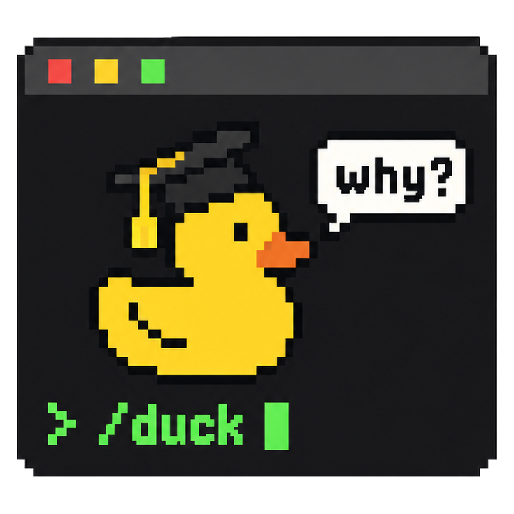

<p align="center">
  <picture>
    <source media="(prefers-color-scheme: dark)" srcset="assets/logo-dark.png">
    
  </picture>
</p>

<h1 align="center">DeepSeek-Ducktor</h1>

<p align="center">
  <a href="https://github.com/HKUSTDial/Supervisor-Skills"><b>Supervisor-Skills</b></a>
  <a href="https://github.com/HKUSTDial/Supervisor-Skills/stargazers"></a>
  的进一步实践
</p>

<p align="center">
  <b>面向 AI 科研时代的「方法论与认知闭环」插件，DeepSeek Harness 原生版</b><br>
  当 Agent 将科研流程加速为 <code>Data In, Paper Out</code> 的黑盒，研究者如何避免沦为被动的旁观者？<br>
  DeepSeek-Ducktor 把 <a href="https://github.com/yinwu01/Ducktor">Ducktor</a> 完整装进 DeepSeek Harness，在推进研究的同时，为你补齐缺失的导师指引与科研训练闭环。<br>
  <b>Trust me, I'm a Ducktor.</b>
</p>

<p align="center">
  <sub>当前处于早期测试阶段（Early Preview），欢迎提交 Issue 或 PR，我们将持续快速迭代。</sub>
</p>

<p align="center">
  
  <a href="#许可证-license"></a>
</p>

<p align="center">
  
</p>

<p align="center">
  <sub>社区做的插件，不是 DeepSeek 官方出品，和 DeepSeek 公司没有关系。</sub>
</p>

<p align="center">
  <sub>简体中文 · <a href="docs/README.en.md">English</a></sub>
</p>

---

## 为什么做 Ducktor

在 **Vibe Research** 浪潮下，编码与科研 Agent 极大地压缩了从实验到成文的周期。但这也是我们在开源 [Supervisor-Skills](https://github.com/HKUSTDial/Supervisor-Skills)（）并获得学界与业界广泛认可后，愈发担忧的一个问题：**当 AI 接管了执行细节，研究者（尤其是高年级本科生与低年级研究生）还能否从科研过程中习得真正的学术判断力？**

在社区反馈中我们发现，许多研究者依赖 `Supervisor-Skills` 获取结构化的科研认知，但静态的技能库仍缺少**伴随式的实时指导**。与此同时，当前多数自动化科研工具本质上是一个开环系统：**Data In, Paper Out**。Agent 替你完成了所有隐性决策（如何界定核心贡献、结论下到什么分寸、消融实验如何归因），而人却被排除在思考回路之外。

**Ducktor 旨在打破这种「执行加速、认知空心化」的困境，构建属于研究者的知识闭环：**

1. **注入顶尖学术品味**：输入不再只是实验数据，还将顶尖学者的方法论、审稿标准与你们课题组的经验共同作为上下文约束。
2. **过程拆解与实时对齐**：在 Agent 推进研究的关键节点，Ducktor 主动暴露背后的学术取舍（Trade-offs），将隐性判断转化为可习得的显性原则。
3. **能力与成果双重沉淀**：在打磨出高质量论文的同时，生成可溯源的决策日志与个人科研笔记，让研究者的学术直觉与 Agent 同步进化。

**DeepSeek-Ducktor** 是我们为 DeepSeek Harness 做的原生插件：把 Ducktor 原样装进去，让你在 DeepSeek Harness 里也能用 `/duck-review` 这类命令；另外加了 Web 界面里的「Ducktor」页签和 11 张经验卡。

<details>
<summary><b>💡 为什么取名为 Ducktor？</b></summary>
<br>
灵感源于软件工程中的<a href="https://zh.wikipedia.org/wiki/%E5%B0%8F%E9%BB%84%E9%B8%AD%E8%B0%83%E8%AF%95%E6%B3%95">小黄鸭调试法（Rubber Duck Debugging）</a>：工程师通过向桌上的小黄鸭逐行解释代码逻辑，在自我审视与复述中发现盲区、厘清思路。<b>Ducktor（Duck + Doctor/Mentor）</b> 扮演的正是终端里这只戴博士帽的“学术小黄鸭”：通过高频、轻量的方法论互动，帮你夺回对研究过程的掌控力与思考深度。
</details>

---

## 核心体验：之前 vs. 之后

当你把实验结果交给常规 AI 撰写论文时，AI 会一次性输出初稿。**核心贡献如何提炼、结论措辞的强弱边界、对比基线的合理性**，全部由模型在黑盒中自行决断。它也许在最后提几句，但不拆成道理，不给出处，也不记下来。

引入 Ducktor 后，AI 照样把活干完，但同样的任务被重构为透明的教研闭环：
- 使用 `/duck-outline` 梳理主线逻辑，`/duck-write` 撰写正文，`/duck-review` 以审稿人视角严苛自查。
- 也可以直接发 `/duck` 加问题，例如 `/duck 可不可以告诉我这个内容里我要学什么？`，Ducktor 先说按哪条命令处理，再照那条命令讲。
- 每完成一个关键阶段，Ducktor 都会讲清**这一步最要紧的取舍（Why）**：常见的另一种做法、为什么这样选、什么条件下不成立（这一步只是按部就班时，一句话带过）；有值得带走的**科研原则（Principle）**和**下次可以主动前置的做法（Next Time）**时，一并讲出。讲到的原则记进 `.duck/notebook.md`，也出现在「Ducktor」页签里。

---

## 核心机制与工作流

DeepSeek-Ducktor 并不替换你现有的模型，而是作为一套规则、技能与界面层，引导 AI 扮演严谨的学术导师。

### 1. 双模式运行与「证据护栏」

刚装好时，Ducktor 在每个项目里都没开启，只在你敲 `/duck-*` 命令时介入。在项目里敲 `/duck on`，开启当前项目的**伴随指导模式**：

* **即时方法论点拨**：AI 做完一步实质性的工作（定了方法、改了实验、写完一段），Ducktor 在回复末尾用一两行讲为什么。
* **关键决策前置征询**：会改变做法的决定，AI 动手之前先问你，一次最多问三件。你说过「这类事我想自己定」的，这一类一律先问。
* **决策溯源**：有取舍时，Ducktor 记一行决策，写明是你定的还是 AI 定的。
* **结果入文前的「证据护栏」**：你要 AI 把实验结果写进表格或论文时，动手前先看三件事：只跑了一次、或者差距没和结果本身的波动比过；提升很大，却没拆出来源；结论说得比证据强。撞上了先停下来问你。不是计算机方向的，换成你那一行的标准（比如样本量、看过数据才定的分析、效应量和置信区间）。

`/duck quiet` 照样先问、照样记，只是不在对话里讲。`/duck off` 回到刚装好的样子：平时不出声，敲命令时照常讲、照常记。

### 2. 事后追问（`/duck-why`）与阶段复盘（`/duck-learn`）

* **即时追问**：AI 已经做完了，你也可以随时问 `/duck <你的问题>`，或用 `/duck-why` 针对刚才的操作（或指定的文件、段落）讲最值得学的一处判断：常见做法和有经验的人为什么这样选、什么条件下不成立、该核对的文件和行号。这一步是你拍板的、你又没说过理由时，它先问一句你当时怎么想的。名家和经验卡的道理化成经验讲，出处写进报告，你问起时直接给。
* **阶段复盘**：一个阶段告一段落时用 `/duck-learn`。它先读这一段的记录，对比本来想干什么和实际怎样，指出有经验的导师会盯的薄弱环节，列出这次交给 AI 的判断，给一到两条下一步；上一次复盘的下一步做了没有，也照实说。最后请你回看一件具体的决定，说说会怎么定（可以不答）。

### 3. 网页里的「Ducktor」页签

在 DeepSeek Harness 的 Web 界面里，右侧边栏多一个「Ducktor」页签，把 `.duck/` 里的决策、原则和要你核对的地方摆在对话旁边。它只读本地文件，不花模型的 token；命令行里没有这个页签。详见 [docs/DETAIL.zh.md](docs/DETAIL.zh.md)。

### 4. 个人知识沉淀（`.duck/`）

所有记录都是项目里 `.duck/` 下的 Markdown 文件：笔记本 `notebook.md`、决策记录 `decisions.md`、复盘与讲解报告 `reports/`。可以随论文代码一起提交进 Git；不想提交，把 `.duck/` 写进 `.git/info/exclude`。

### 5. 可溯源的导师知识库

规则要求 Ducktor：讲道理时，依据只从经验卡、名家文章的转述（`cards/MENTORS.md`）和科研手册（`handbook/`）的具体章节里取。对话里化成经验来讲，人名、文章和卡号写进报告，你问起时直接给；找不到依据，就直说这是它自己的判断。

经验卡有两组。Ducktor 带 23 张。这个插件另带 11 张（`mentor/cards/`），讲读论文、进新方向、实验习惯、和导师开会、用 AI 做研究和审稿的规矩。每张写明出处，附原文链接。写卡时对过原文，发布前又让两个独立的模型会话当红队逐条复核过（不是人工审）。

---

## 仓库架构

* `index.js`：dsh 插件入口。把 `duck/skills/` 下的 14 条命令登记成技能（技能的基础目录就是 Ducktor 根目录，命令里「相对插件根目录」的路径因此对得上）；在每一步模型请求之前检查开场说明是否需要给、是否过期。
* `lib/duck.js`：和 dsh 无关的部分（找根目录、读 SKILL.md、生成和判断开场说明），单元测试直接用 Node 跑。开场说明后面那段 DeepSeek Harness 附注也在这里，附注里还写着另带的卡片在哪、参考文献要带链接、第一次摸方向时写 `background.md`。
* `client/client.js`：「Ducktor」页签，手写的浏览器端插件，不用打包；React 用页面自带的那份，文件通过 dsh 的工作区文件接口读。
* `lib/cards.js`：读卡片（Ducktor 的和 `mentor/cards/` 的），服务端读好后随网页一起发给页签。
* `mentor/cards/`：本插件另带的 11 张经验卡片，格式和 Ducktor 的卡一样，卡号不重；`INDEX.md` 由 `node scripts/mentor-index.mjs` 生成。
* `duck/`：Ducktor 原样拷贝，不手改。`duck.lock.json` 记着来自哪个提交和每个文件的 sha256。更新 Ducktor：

  ```sh
  node scripts/sync-duck.mjs --from /path/to/Ducktor --ref main
  npm test
  ```

插件运行时只读本地文件，自己不发网络请求；服务端只用 dsh 自带的三个包（`@deepseek-ai/schemastery`、`@deepseek-ai/dsh-skill`、`@deepseek-ai/dsh-llm`），页签只用页面自带的 React，没有别的依赖。

---

## 安装与快速开始

让你的 agent 帮忙，把下面这段话发给它：

```text
帮我安装 DeepSeek-Ducktor 插件：https://github.com/yinwu01/DeepSeek-Ducktor
照仓库 README 里「安装与快速开始」一节的步骤装好，装完告诉我怎么开始用。
```

也可以照下面的步骤自己装。

**环境要求**：DeepSeek Harness 0.2.1-rc.2 及以上、0.3 以下（`package.json` 的 `engines.dsh`，dsh 安装时会检查）。
*(注：当前仓库处于私有测试期，请先确认你的 GitHub 账号已开通访问权限，可通过 `gh repo view yinwu01/DeepSeek-Ducktor` 验证。)*

三种方式任选一种。方式二、方式三都是让 dsh 直接用你放仓库的那个文件夹，不复制（方式一走的是和方式二同一套安装，没单独核对过）：装好以后，这个文件夹别删、别挪，要挪就先卸载，挪完重装。项目里的 `.duck/` 是学生自己的记录，装、卸插件都不会动它。

### 方式一：插件页（Web、Desktop）

1. 把这个仓库放到本机任意位置（`git clone` 或下载解压）。
2. 在 DeepSeek Harness 里打开侧边栏的「插件」，选「安装第三方插件」，在「包名或地址」里填仓库的绝对路径，例如 `/Users/you/DeepSeek-Ducktor`。
3. 装好就生效，不用重启。插件卡片上显示「DeepSeek-Ducktor」。

卸载在同一页面里点「卸载」。npm 装的 dsh 用 PATH 上的 `pnpm` 装插件；Desktop 自带 pnpm。

### 方式二：命令行

```sh
dsh plugin --profile web add /绝对路径/DeepSeek-Ducktor
dsh plugin --profile headless add /绝对路径/DeepSeek-Ducktor
```

第一行装给浏览器里的 `dsh web`，第二行装给终端里直接敲的 `dsh`（headless）。只用其中一种，就只跑那一行。每个 profile 单独装，需要 PATH 上有 `pnpm`。装的时候 pnpm 会打一段 `peerDependencies` 的 WARN（「This might cause issues in your project」），说这些包要从 dsh 那边找：插件运行时用的就是 dsh 自带的那几个包，这段警告可以不管；它提示升级 pnpm 的那几行也不用管。卸载把 `add /绝对路径/DeepSeek-Ducktor` 换成 `remove deepseek-ducktor`。

Desktop 的 profile 名是 `desktop`：先打开一次 Desktop，完全退出，再用 Desktop 自带的 `dsh` 命令（Desktop 菜单「管理 dsh 命令…」可以把它注册到终端）运行 `dsh plugin --profile desktop add /绝对路径/DeepSeek-Ducktor`，然后重新打开 Desktop。

### 方式三：不装 pnpm（命令行）

在 `~/.dsh/cordis.patch.yml`（设了 `DSH_HOME` 就是 `$DSH_HOME/cordis.patch.yml`）里加一行：

```yaml
- insert:
    - id: deepseek-ducktor
      name: /绝对路径/DeepSeek-Ducktor/index.js
```

这一行对所有 profile 生效，下次启动 dsh 时加载。卸载就删掉这一行。

Desktop 用户不要用这种方式：这一行对 Desktop 也生效，会盖过插件页装的那一份，而它在 Desktop 里能不能找到 dsh 自带的包没测过。Desktop 请用方式一。

这一行和方式一、二装上的那一行 id 相同，会盖过它们，不会注册两遍。所以要改设置，也写在这一行里（见「设置」）。

### 启动验证

1. 开一个新会话，在输入框里敲 `/`，能看到全部 14 条命令。方式一装好就生效；方式二、方式三装好以后，先重启一次 dsh（Desktop 要重新打开）。
2. 从 `/duck` 开始，它会列出菜单。命令行的 headless 没有输入框，也不用重启：`dsh plugin --profile headless list` 里有 `deepseek-ducktor` 就是装上了，再到项目文件夹里跑 `dsh --profile headless "/duck"`。
3. 希望在日常对话中开启伴随指导，在项目里敲一次 `/duck on`。开关存在当前项目的 `.duck/config.md` 里，不影响其他项目。

<details>
<summary><b>以前装过旧版本（deepseek-doctor、deepseek-supervisor）</b></summary>
<br>

以前用方式一、二装过这个插件的，先卸载旧的，再更新文件夹（`git pull`，或重新下载解压），最后照上面装。旧 id 是 deepseek-doctor 或 deepseek-supervisor，最早的版本是 deepseek-ducktor。插件页里，旧插件卡片的标题是「DeepSeek-Doctor」，或以「Doctor Duck」开头，点这张卡片上的「卸载」。用命令行卸载时，在每个装过的 profile 里运行 `dsh plugin --profile <名字> remove <旧 id>`。已经更新过文件夹的，也用这条命令按旧 id 卸载。旧 id 是 deepseek-doctor 或 deepseek-supervisor 的，不卸载的话，dsh 会同时加载新旧两个插件。

以前用方式三装过的，不用卸载。更新文件夹以后，把那一行的 id 改成 deepseek-ducktor，文件夹换了位置或名字的话路径也改，`config:` 留着，不用再加一行。

id 从 deepseek-doctor 或 deepseek-supervisor 换过来以后，插件页「配置」里改过的设置不会转到新 id 下。改过设置的，装好以后在「配置」里再改一次。

</details>

### 设置

三项都可以不填。用方式一、二装的，在插件页插件的「配置」里改。用了方式三那一行的，改那一行的 `config:`；它优先级更高，插件页里改的会被它盖过（插件页会提示「被更高优先级的配置覆盖」）：

```yaml
- insert:
    - id: deepseek-ducktor
      name: /绝对路径/DeepSeek-Ducktor/index.js
      config:
        duckRoot: /绝对路径/Ducktor
        sessionContext: true
        subagents: false
```

| 字段 | 默认 | 说明 |
|---|---|---|
| `duckRoot` | 插件自带的 `duck/` | 用你自己的 Ducktor 目录，必须是绝对路径 |
| `sessionContext` | `true` | 关掉以后只剩命令，会话不再带开场说明和常驻规则 |
| `subagents` | `false` | 子代理会话也带开场说明。默认不带，因为子代理没法停下来问学生 |

---

## 命令参考

| 命令 | 核心作用与适用场景 |
| :--- | :--- |
| `/duck [on \| quiet \| off]` | **总控与智能路由**。不带参数时展示菜单；`on` 开启项目伴随模式；`quiet` 照样先问、照样记，不在对话里讲；`off` 恢复按需触发模式。后接自然语言（如 `/duck 帮我写引言`）时，自动匹配并执行对应子命令。 |
| `/duck-survey` | **文献调研**：探索研究方向，生成结构化文献综述。 |
| `/duck-idea` | **课题评估**：审视研究 Idea 的新颖性、可行性与潜在审稿风险。 |
| `/duck-vibe` | **人机边界划分**：评估当前模块哪些工作可托管给 AI，哪些核心科学判断必须由研究者亲自把关。 |
| `/duck-outline` | **逻辑架构**：梳理整篇论文的论证脉络（内置技术论文与 Benchmark 论文双模板）。 |
| `/duck-intro` | **引言撰写**：构建“背景→挑战→方法映射→贡献”严密咬合的 Introduction。 |
| `/duck-write` | **正文撰写**：基于真实实验证据撰写方法与实验章节，严控引用真实性。 |
| `/duck-figure` | **图表设计**：规划科研图表结构并核查可视化信息密度与规范。 |
| `/duck-polish` | **学术润色**：提升学术表达的精准度、可读性与行文节奏。 |
| `/duck-review` | **模拟审稿**：在投稿前以顶会 Reviewer 的严苛视角对稿件进行全面体检。 |
| `/duck-why` | **方法论溯源**：剖析上一步操作（或指定文件、段落）背后的学术取舍与依据。 |
| `/duck-learn` | **阶段性复盘**：对比预期与结果，诊断薄弱环节，盘点交给 AI 的隐性决策。 |
| `/duck-notes` | **知识库管理**：查看、检索或编辑本地沉淀的 `.duck/notebook.md` 科研原则。 |
| `/duck-skill` | **定制与扩展**：启停特定命令、针对当前项目微调规则，或注入课题组专属经验卡。 |

*注：在 DeepSeek Harness 里，这些命令只能由你在输入框里敲，模型不会自己调用。全部命令和开关的说明见 [docs/DETAIL.zh.md](docs/DETAIL.zh.md)。*

---

## 和 Claude Code、Codex 版有什么不同

| | Claude Code、Codex | DeepSeek Harness（本插件） |
|---|---|---|
| 命令 | Claude Code 里 `/duck-review`，Codex 里 `$duck:duck-review` | `/duck-review`，输入框敲 `/` 能看到全部 14 条；只能学生敲，模型不会自己调用 |
| 开场说明 | 开场 hook 在会话开始时注入一次 | 每个会话的第一次模型请求带上；`.duck/config.md` 改了，或者对话被压缩过，下一步再给一份。会话中途 `/duck on`，常驻规则当场就到 |
| 生成开场说明的代码 | Ducktor 的 `bin/duck.js` | 同一份 `bin/duck.js`，后面加一段 DeepSeek Harness 附注：工具对照（read、glob、grep）、项目目录的绝对路径 |
| 读插件里的文件 | Claude Code 里插件给 Read、Glob、Grep 开了绿灯 | dsh 的每种沙箱模式都不拦读文件，不用学生批准；插件目录只读 |
| 学生自己加的命令 | 放项目的 `.claude/skills/duck-xxx/` 或 `.agents/skills/duck-xxx/` | dsh 只读 `.agents/skills/`（和 `.dsh/skills/`），不读 `.claude/skills/`。名字别和插件的 14 条重复：dsh 里插件自带的技能优先级最低，同名的会盖过插件的命令 |
| 项目目录 | 开场 hook 收到的目录 | 会话创建时的目录。开场说明里写明它和 `.duck/` 的绝对路径，让模型在会话里换了工作目录也读写原来的 `.duck/`（模型照不照做，没用真模型验证） |

---

## 测试与验证

| 命令 | 要什么 | 测什么 |
|---|---|---|
| `npm test` | Node 22 以上 | 单元测试和打包检查，不需要 dsh |
| `node tests/dsh/check.mjs --route pnpm --web`（或 `--route patch`、`--route ui`） | Node 22.15 以上（读会话日志要 zstd），装好的 dsh；`pnpm` 和 `ui` 两条还要 PATH 上有 pnpm | 在临时 HOME 里按三种方式装、用、卸，读真实的会话日志核对注入的内容和位置。不需要也不使用 API key，模型请求发出前就停下 |
| `node tests/web/sidebar.mjs <dsh web 打印的地址> <输出前缀> <项目目录> [poll] [dark]` | 一个开着的 `dsh web`（web profile 装了插件），`PLAYWRIGHT_CORE` 和 `CHROMIUM` 指向 playwright-core 和一个 Chromium | 在真的网页界面里打开「Ducktor」页签、截图；带 `poll` 时往 `decisions.md` 追加一行，看页签自己刷新出来。不发模型请求 |
| `node tests/e2e/flow.cjs [main\|more\|loop\|paper]` | Node 22.15 以上，`DEEPSEEK_API_KEY`，dsh 的 headless profile 里装好插件 | 真模型跑 Ducktor 的整套学生流程，检查项和 Claude Code、Codex 版相同，另有几条只查这个插件。花真钱 |

`check.mjs` 建议在断网的环境里跑（例如 `unshare -rn`，打开 loopback），这样能确认没有东西出本机。

细节在 [docs/验证记录.md](docs/验证记录.md)。简单说：

- 验证了：dsh 0.2.1-rc.2 和 rc.3 上三种安装方式都能装上、卸载（卸载后不再加载）；命令在 Web 和 headless 里都列出来、指向真实文件；开场说明和 Ducktor 开场 hook 的输出逐字相同，位置在学生消息之后、命令之前；续接会话不重复给，开关变了给替换的一份；照 dsh 建子代理会话的写法、用被测 dsh 的代码建出会话，插件认得出子代理（dsh 真建子代理时这么写，是读代码确认的）。
- 真模型（10-25、10-26 跑的，用的是 10-27 同步以前的 `duck/` 和那时的检查项）：在 dsh rc.2 上用 DeepSeek（默认的 `deepseek-flash`）跑完 Ducktor 的四套学生流程，必须项全过；建议项里有一条没过：参考文献没给链接（10-26 只重跑了 survey 这一段，这一条过了）。运行里模型起的真子代理都没拿到开场说明；调低压缩阈值后，对话压缩掉开场说明，插件在下一步补发了。
- 没验证：rc.3 和 `deepseek-v4-pro` 上的真模型流程，真模型结果的波动（每套只跑了一次）；10-27 同步以后的真模型流程（这次同步改了规则和命令的内容，不只是名字：菜单、`/duck-why`、名家文章的转述）；红队改过的 11 张卡还没被真模型读过；Desktop（只有 macOS、Windows 版，我们只在 Linux 上测过）；插件页的点击流程本身（测的是它调用的后端接口），插件的「配置」页也没看过；模型换了工作目录后照不照附注里的路径读写 `.duck/`（流程里模型没换过目录）。

---

## 常见问题 (FAQ)

<details>
<summary><b>1. 是 DeepSeek 官方的插件吗？</b></summary>
<br>
不是。这是社区做的插件，和 DeepSeek 公司没有关系。
</details>

<details>
<summary><b>2. 和 Ducktor 是什么关系？</b></summary>
<br>
<code>duck/</code> 是 Ducktor 的原样拷贝，<code>duck.lock.json</code> 记着它来自哪个提交。这个插件加的是 DeepSeek Harness 的接入、「Ducktor」页签和另带的 11 张卡。
</details>

<details>
<summary><b>3. 会把我的东西发出去吗？</b></summary>
<br>
插件自己不发网络请求，页签只读项目里的本地文件。AI 读到的内容照常发给模型。<code>/duck-survey</code>、<code>/duck-idea</code> 这类命令会让 AI 上网查文献；Ducktor 开着或你敲命令时，AI 给论文、数据集附的链接也要上网查。
</details>

<details>
<summary><b>4. Ducktor 讲的方法论或引用的数据会出错吗？</b></summary>
<br>
<b>有可能，请始终保持研究者的最终核验权。</b>外部文献请点链接核对标题与摘要；文内数据请对照源文件复核（<code>/duck-why</code> 会给出要核对的文件和行号）。复盘时关于“AI 当时为何这样做”的分析，是照文件和对话记录推出来的，不代表模型当时真实的推理。
</details>

<details>
<summary><b>5. 会对研究者进行能力评分吗？</b></summary>
<br>
不会。Ducktor 不出考题，也不对使用者打分。<code>/duck-idea</code> 评估的是课题方案，<code>/duck-review</code> 审视的是论文手稿：<b>我们评估的是研究客体，而非研究者本人。</b>
</details>

<details>
<summary><b>6. 以前叫什么？</b></summary>
<br>
2026-10-25 的第一版叫 deepseek-ducktor。10-26 改名 deepseek-supervisor，10-27 改名 deepseek-doctor（显示名 DeepSeek-Doctor），10-29 改回 deepseek-ducktor。里面的 Ducktor 在 10-27 以前叫 Doctor Duck。<code>evals/runs/</code> 和 <code>docs/验证记录.md</code> 里的旧记录保留了当时的名字。装过旧版本的，见「安装与快速开始」里的旧版本说明。
</details>

---

## 来源与致谢

* **命名灵感**：源自《程序员修炼之道》（*The Pragmatic Programmer*）提出的小黄鸭调试法（[Rubber Duck Debugging](https://en.wikipedia.org/wiki/Rubber_duck_debugging)）。
* **核心方法论与技能库**：本插件内置的 [Ducktor](https://github.com/yinwu01/Ducktor) 改编自香港科技大学（广州）数据智能与分析实验室开源的 [Supervisor-Skills](https://github.com/HKUSTDial/Supervisor-Skills)（骆昱宇及贡献者，CC BY-NC-SA 4.0）。
* **示例数据说明**：动图里滚过的 LaTeX 行，取自一次 Claude Code 运行写的论文；右边窗口第 49 行讲翻译难在哪，是为示意另加的，后面的行号随之后移；论文数字取自《Attention Is All You Need》（[arXiv 1706.03762](https://arxiv.org/abs/1706.03762)）的表 2 和表 3。
* **Supervisor 系列**：我们正式将 Supervisor 作为一个实验室系列：[Supervisor-Skills](https://github.com/HKUSTDial/Supervisor-Skills) 是系列的第一个，[Ducktor](https://github.com/yinwu01/Ducktor) 与 DeepSeek-Ducktor 是第二和第三个。接下来我们还会继续开源，并与社区合作。

---

## 许可证 (License)

本项目采用分目录多重许可策略：
* **插件代码和配置**（`index.js`、`lib/`、`client/`、`scripts/`、`tests/`、`cordis.patch.yml`）：**MIT**。
* **文档、展示文字和图**（`README.md`、`docs/`、`locale/`、`assets/`、`icon.png`）、运行记录（`evals/`）和另带的经验卡片（`mentor/`）：**CC BY-NC-SA 4.0**，和 Ducktor 的文字一样（里面有改写自 Ducktor 的段落）。
* **`duck/`**：Ducktor 原样拷贝，按它自己的 `duck/LICENSE` 分目录许可：文字（skills/、rules/、cards/、handbook/）是 CC BY-NC-SA 4.0，不可商用；`library/` 里的原技能各自保留原来的许可（CC BY 4.0 或 CC BY-NC-SA 4.0）；代码是 MIT。
* 截图里的 DeepSeek Harness 界面归其所有者，不在本许可内。

完整许可条款请参阅 [LICENSE](LICENSE)。

---

## 加入交流群

群已超过 200 人，无法通过二维码直接入群。请扫码添加管理员微信 `xyp619`，备注 **"Ducktor + 姓名"**，由管理员邀请入群。您也可以关注 **数据智能与分析实验室 DIAL 官方公众号** 与 **蟹哥聊科研**，获取科研资讯、论文写作经验、AI 前沿动态与科研工具分享。

加入后您可以：
- 🔔 第一时间获取项目更新
- 💬 与同路人交流论文写作、AI 辅助科研心得
- 🎙️ 参与不定期的线上答疑与经验分享活动

<table align="center">
  <tr>
    <td align="center" width="360">
      <strong>微信交流群</strong>
    </td>
    <td align="center" width="360">
      <strong>官方公众号</strong>
    </td>
    <td align="center" width="360">
      <strong>科研分享号</strong>
    </td>
  </tr>
  <tr>
    <td align="center" valign="middle" height="360">
      
    </td>
    <td align="center" valign="middle" height="360">
      
    </td>
    <td align="center" valign="middle" height="360">
      
    </td>
  </tr>
  <tr>
    <td align="center">
      <sub>添加管理员 xyp619，邀请入群交流</sub>
    </td>
    <td align="center">
      <sub>数据智能与分析实验室 DIAL 官方公众号</sub>
    </td>
    <td align="center">
      <sub>蟹哥聊科研：AI 前沿、论文与科研工具分享</sub>
    </td>
  </tr>
</table>
