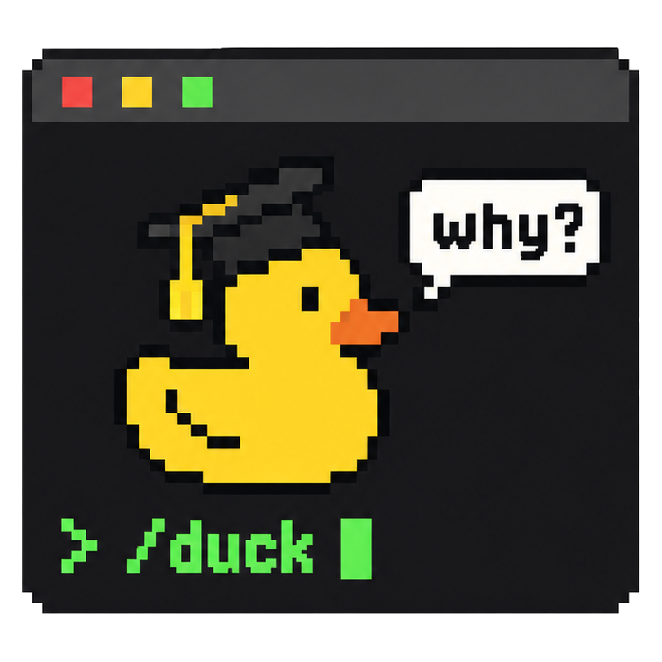

<p align="center">
  <picture>
    <source media="(prefers-color-scheme: dark)" srcset="../assets/logo-dark.png">
    
  </picture>
</p>

<h1 align="center">DeepSeek-Ducktor</h1>

<p align="center">
  The next step of
  <a href="https://github.com/HKUSTDial/Supervisor-Skills"><b>Supervisor-Skills</b></a>
  <a href="https://github.com/HKUSTDial/Supervisor-Skills/stargazers"></a>
</p>

<p align="center">
  <b>A methodology and learning-loop plugin for research in the age of AI, native to DeepSeek Harness</b><br>
  When agents turn research into a black box of <code>Data In, Paper Out</code>, how does a researcher avoid becoming a passive spectator?<br>
  DeepSeek-Ducktor brings all of <a href="https://github.com/yinwu01/Ducktor">Ducktor</a> into DeepSeek Harness. While your research moves forward, it adds the missing mentor guidance and the training loop of research.<br>
  <b>Trust me, I'm a Ducktor.</b>
</p>

<p align="center">
  <sub>Early Preview. Issues and PRs are welcome, and we iterate quickly.</sub>
</p>

<p align="center">
  
  <a href="#license"></a>
</p>

<p align="center">
  
</p>

<p align="center">
  <sub><a href="../README.md">简体中文</a> · English</sub><br>
  <sub>This file is a translation of the Chinese README. If the two files are different, the Chinese file is correct. Ducktor's rules, commands and cards are in Chinese.</sub>
</p>

---

## Why Ducktor

In the wave of **Vibe Research**, coding and research agents have greatly shortened the path from experiment to paper. After we open-sourced [Supervisor-Skills](https://github.com/HKUSTDial/Supervisor-Skills) () and it was widely recognized in academia and industry, one question worried us more and more: **when AI takes over the details of execution, can researchers (especially senior undergraduates and junior graduate students) still learn real academic judgment from the research process?**

From community feedback, we found that many researchers rely on `Supervisor-Skills` for structured research knowledge, but a static skill library still lacks **guidance that comes with you, in real time**. At the same time, most automated research tools today are open-loop systems: **Data In, Paper Out**. The agent makes all the hidden decisions for you (how to define the core contribution, how strong a conclusion to state, how to attribute an ablation), and the human is left out of the thinking loop.

**Ducktor sets out to break this pattern of "faster execution, hollow understanding" and to build a learning loop for the researcher:**

1. **Bring in top academic taste**: the input is no longer only experimental data. The methods of top scholars, review standards, and the experience of your own group are also part of the context.
2. **Break the process down and stay aligned in real time**: at the key points where the agent moves the research forward, Ducktor shows the academic trade-offs behind them and turns hidden judgments into explicit principles that you can learn.
3. **Grow both skill and output**: while you polish a high-quality paper, Ducktor produces a traceable decision log and personal research notes, so that the researcher's academic intuition grows together with the agent.

**DeepSeek-Ducktor** is our native plugin for DeepSeek Harness: it puts Ducktor in unchanged, so that you can use commands such as `/duck-review` in DeepSeek Harness too, and it adds the "Ducktor" tab in the web interface and 11 more experience cards.

<details>
<summary><b>💡 Why the name Ducktor?</b></summary>
<br>
The idea comes from <a href="https://en.wikipedia.org/wiki/Rubber_duck_debugging">rubber duck debugging</a> in software engineering: an engineer explains the code, line by line, to a rubber duck on the desk, and finds the blind spots and clears up the thinking while explaining. <b>Ducktor (Duck + Doctor/Mentor)</b> is this "academic rubber duck" in a graduation cap in your terminal: with frequent, light interactions about method, it helps you take back control of the research process and the depth of your thinking.
</details>

> [!TIP]
> **Using Claude Code or Codex?** Use [Ducktor](https://github.com/yinwu01/Ducktor/blob/main/i18n/README.en.md): the same commands and rules as DeepSeek-Ducktor, the original version for Claude Code and Codex.

---

## Join the discussion group

The group has exceeded 200 members and can no longer be joined via QR code. Please scan to add the admin on WeChat (`xyp619`) with the remark **"Ducktor + your name"** to be invited in. You can also follow the official WeChat account of the **Data Intelligence and Analytics Lab (DIAL)** and **Xie Bro Talks Research** for research news, paper-writing tips, AI frontier updates, and research tool sharing.

By joining, you get:
- 🔔 First-hand updates on the project
- 💬 Exchange paper writing and AI-assisted research tips with peers
- 🎙️ Join occasional online Q&A and experience-sharing sessions

<table align="center">
  <tr>
    <td align="center" width="360">
      <strong>Discussion Group</strong>
    </td>
    <td align="center" width="360">
      <strong>Official Account</strong>
    </td>
    <td align="center" width="360">
      <strong>Research Updates</strong>
    </td>
  </tr>
  <tr>
    <td align="center" valign="middle" height="360">
      
    </td>
    <td align="center" valign="middle" height="360">
      
    </td>
    <td align="center" valign="middle" height="360">
      
    </td>
  </tr>
  <tr>
    <td align="center">
      <sub>Add admin xyp619 to join the group</sub>
    </td>
    <td align="center">
      <sub>Data Intelligence and Analytics Lab (DIAL)</sub>
    </td>
    <td align="center">
      <sub>Xie Bro Talks Research: AI, papers, and research tools</sub>
    </td>
  </tr>
</table>

---

## The core experience: before vs. after

When you give your experimental results to a regular AI to write the paper, the AI produces a first draft in one pass. **How to state the core contribution, how strong the wording of a conclusion may be, whether the baselines are reasonable**: the model decides all of these by itself, inside a black box. It may mention a few points at the end, but it does not turn them into principles, gives no sources, and records nothing.

With Ducktor, the AI still finishes the work, but the same task becomes a transparent loop of teaching and research:
- Use `/duck-outline` to set the main line of the argument, `/duck-write` to write the body, and `/duck-review` to check the draft strictly, as a reviewer would.
- You can also send `/duck` followed by a question, for example `/duck 可不可以告诉我这个内容里我要学什么？` ("Can you tell me what I should learn here?"). Ducktor first says which command it uses, then explains with that command.
- After each key stage, Ducktor explains **the most important trade-off of this step (Why)**, picking what applies from the common alternative, why this choice, and when it does not hold (when the step was routine, one sentence says so). When there is **a research principle that carries over (Principle)** or **an action you can take earlier next time (Next Time)**, it says that too. The principles go into `.duck/notebook.md` and also show in the "Ducktor" tab.

---

## Core mechanisms and workflow

DeepSeek-Ducktor does not replace your model. It is a layer of rules, skills and interface that leads the AI to act as a careful academic mentor.

### 1. Two modes and the "evidence guardrail"

Right after the install, Ducktor is not on in any project, and it speaks only when you type a `/duck-*` command. Type `/duck on` in a project to turn on **companion mode** for that project:

* **Short notes on method, right away**: when the AI finishes a real step of work (it chooses a method, changes an experiment, or finishes a paragraph), Ducktor adds one to three lines at the end of the reply about why.
* **Ask before key decisions**: for a decision that changes the approach, the AI asks you before it acts, at most three things at a time. If you said you want to decide a kind of judgment yourself, it always asks about that kind.
* **Decision history**: when there is a trade-off, Ducktor records one decision line and writes whether you or the AI decided.
* **The "evidence guardrail" before results go into the paper**: when you ask the AI to put experimental results into a table or the paper, it first checks three things: the experiment ran only once, or the gap was not compared with the result's own variation; a large gain, but its source is not separated; a conclusion stronger than the evidence. If one applies, it stops and asks you first. Outside computer science it uses your field's standards instead (for example sample size, analyses chosen after seeing the data, effect sizes and intervals).

`/duck quiet` still asks first and still records, but does not explain in the conversation. `/duck off` goes back to the state right after the install: quiet in everyday work, with the usual explanations and records when you type a command.

### 2. Ask afterwards (`/duck-why`) and look back on a stage (`/duck-learn`)

* **Ask right away**: even after the AI has finished, you can ask `/duck <your question>` at any time, or use `/duck-why` on the last action (or a file or paragraph that you name). It explains the one judgment most worth learning: the common approach and why experienced people choose this one, when that does not hold, and the files and line numbers to check. If you made this call and never said why, it first asks what you were thinking. Ideas from the cards and well-known researchers are turned into experience; the sources go into the report, and it gives them when you ask.
* **Look back on a stage**: when a stage ends, use `/duck-learn`. It reads the records of this stretch first, compares what you meant to do with what happened, points out the weak spots an experienced advisor would examine, lists the judgments left to the AI, and gives one or two next steps; when the records touch the last look-back's next steps, it says whether they were done. At the end it asks you to look back on one concrete decision and say how you would decide it now (you can skip it).

### 3. The "Ducktor" tab in the web interface

In the DeepSeek Harness web interface, the right sidebar gets a "Ducktor" tab that puts the decisions, the principles and what you should check yourself from `.duck/` next to the conversation. It only reads local files and costs no model tokens; the command line has no tab. See [DETAIL.md](DETAIL.md).

### 4. Personal knowledge (`.duck/`)

All records are Markdown files in `.duck/` of the project: the notebook `notebook.md`, the decision log `decisions.md`, and the look-back and explanation reports in `reports/`. You can commit them to Git with your paper and code; if you do not want to, add `.duck/` to `.git/info/exclude`.

### 5. A traceable mentor knowledge base

The rules tell Ducktor: when it explains a principle, the grounds come only from the experience cards, the summaries of mentors' essays (`cards/MENTORS.md`), and named sections of the research handbook (`handbook/`). In the conversation it turns them into experience; names, titles and card numbers go into the report, and it gives them when you ask. If nothing fits, it says that this is its own judgment.

There are two sets of experience cards. Ducktor has 23. This plugin adds 11 (`mentor/cards/`), on reading papers, entering a new field, experiment habits, meetings with your advisor, and rules for research and review with AI. Each card names its source and links to the original. We checked the cards against the originals when we wrote them, and before release two independent model sessions checked them line by line as a red team (not a human review).

---

## Repository layout

* `index.js`: the dsh plugin entry. It registers the 14 commands in `duck/skills/` as skills (the base folder of the skills is the Ducktor root, so paths "relative to the plugin root" in the commands are correct), and before each model request it checks whether the session note must be given or is out of date.
* `lib/duck.js`: the parts that do not depend on dsh (find the root, read SKILL.md, build and check the session note); unit tests run it with Node directly. The DeepSeek Harness addendum after the session note is also here; it also says where the extra cards are, that references need links, and to write `background.md` the first time you explore a direction.
* `client/client.js`: the "Ducktor" tab, a hand-written browser plugin with no bundling; it uses the React of the page, and reads files through the dsh workspace file interface.
* `lib/cards.js`: reads the cards (Ducktor's and `mentor/cards/`); the server reads them and sends them with the web page to the tab.
* `mentor/cards/`: the 11 extra experience cards of this plugin, in the same format as Ducktor's cards, with different card numbers; `INDEX.md` is generated by `node scripts/mentor-index.mjs`.
* `duck/`: an unchanged copy of Ducktor; do not edit it by hand. `duck.lock.json` records the commit it comes from and the sha256 of each file. To update Ducktor:

  ```sh
  node scripts/sync-duck.mjs --from /path/to/Ducktor --ref main
  npm test
  ```

At run time the plugin reads only local files and sends no network requests itself; the server uses only three packages that come with dsh (`@deepseek-ai/schemastery`, `@deepseek-ai/dsh-skill`, `@deepseek-ai/dsh-llm`), the tab uses only the React of the page, and there are no other dependencies.

---

## Install and quick start

Let your agent help. Send it this message:

```text
Install the DeepSeek-Ducktor plugin for me: https://github.com/yinwu01/DeepSeek-Ducktor
Follow the steps in the "Install and quick start" section of docs/README.en.md in that repository, then tell me how to start.
```

You can also install it yourself with the steps below.

**Requirement**: DeepSeek Harness 0.2.1-rc.2 or later, below 0.3 (`engines.dsh` in `package.json`; dsh checks it at install).
*(Note: the repository is private during this test period. First make sure that your GitHub account has access to it. You can check with `gh repo view yinwu01/DeepSeek-Ducktor`.)*

Choose one of the three ways. Ways 2 and 3 make dsh use the folder where you put the repository, with no copy (way 1 uses the same install as way 2; we did not check it separately): after the install, do not delete or move this folder; to move it, uninstall first, move it, and install again. The `.duck/` folder in a project is the student's own record; installing and removing the plugin does not touch it.

### Way 1: the plugin page (Web, Desktop)

1. Put this repository anywhere on your computer (`git clone`, or download and unzip).
2. In DeepSeek Harness, open "插件" (Plugins) in the sidebar, choose "安装第三方插件" (install a third-party plugin), and enter the absolute path of the repository in "包名或地址" (package name or address), for example `/Users/you/DeepSeek-Ducktor`.
3. It works right after the install, with no restart. The plugin card shows "DeepSeek-Ducktor".

To uninstall, click "卸载" (Uninstall) on the same page. A dsh installed with npm uses the `pnpm` on PATH to install plugins; Desktop comes with pnpm.

### Way 2: command line

```sh
dsh plugin --profile web add /absolute/path/DeepSeek-Ducktor
dsh plugin --profile headless add /absolute/path/DeepSeek-Ducktor
```

The first line installs for `dsh web` in the browser, the second for `dsh` typed in a terminal (headless). If you use only one of them, run only that line. Install for each profile separately; `pnpm` must be on PATH. During the install, pnpm prints a `peerDependencies` WARN ("This might cause issues in your project") saying that these packages must come from dsh: at run time the plugin uses exactly the packages that come with dsh, so you can ignore this warning, and the lines suggesting a pnpm upgrade as well. To uninstall, replace `add /absolute/path/DeepSeek-Ducktor` with `remove deepseek-ducktor`.

The Desktop profile is named `desktop`: open Desktop once, quit it completely, then use the `dsh` command that comes with Desktop (the Desktop menu "管理 dsh 命令…" (manage the dsh command) can register it in your terminal) to run `dsh plugin --profile desktop add /absolute/path/DeepSeek-Ducktor`, and open Desktop again.

### Way 3: without pnpm (command line)

Add one entry to `~/.dsh/cordis.patch.yml` (or `$DSH_HOME/cordis.patch.yml` if you set `DSH_HOME`):

```yaml
- insert:
    - id: deepseek-ducktor
      name: /absolute/path/DeepSeek-Ducktor/index.js
```

This entry works for all profiles and loads the next time dsh starts. To uninstall, delete it.

Desktop users should not use this way: the entry also applies to Desktop and overrides the copy installed from the plugin page, and we did not test whether it can find the packages that come with dsh inside Desktop. On Desktop, use way 1.

This entry has the same id as the one that ways 1 and 2 install, so it overrides them and is not registered twice. So if you change settings, write them in this entry too (see "Settings").

### Check that it works

1. Open a new session and type `/` in the input box; you see all 14 commands. Way 1 works right after the install; after way 2 or 3, restart dsh once (open Desktop again).
2. Start with `/duck`; it lists the menu. The headless command line has no input box and needs no restart: if `dsh plugin --profile headless list` shows `deepseek-ducktor`, it is installed; then run `dsh --profile headless "/duck"` in the project folder.
3. To get mentor guidance in everyday conversation, type `/duck on` once in the project. The mode is saved in `.duck/config.md` of the current project, and other projects do not change.

<details>
<summary><b>If you installed an older version (deepseek-doctor, deepseek-supervisor)</b></summary>
<br>

If you installed this plugin before with way 1 or 2, uninstall the old one first, then update the folder (`git pull`, or download and unzip again), and then install as above. The old id is deepseek-doctor or deepseek-supervisor; the earliest version is deepseek-ducktor. On the plugin page, the old plugin card has the title "DeepSeek-Doctor" or starts with "Doctor Duck"; click "卸载" (Uninstall) on that card. To uninstall from the command line, run `dsh plugin --profile <name> remove <old id>` in each profile where you installed it. If you already updated the folder, also use this command with the old id. If the old id is deepseek-doctor or deepseek-supervisor and you do not uninstall it, dsh loads both the old and the new plugin.

If you installed it before with way 3, you do not need to uninstall. After you update the folder, change the id in that entry to deepseek-ducktor, change the path too if the folder moved or was renamed, keep `config:`, and do not add another entry.

After the id changes from deepseek-doctor or deepseek-supervisor, settings that you changed in "配置" (Configure) on the plugin page do not move to the new id. If you changed settings, change them again in "配置" after the install.

</details>

### Settings

All three are optional. If you installed with way 1 or 2, change them in "配置" (Configure) of the plugin on the plugin page. If you use the entry of way 3, change `config:` in that entry; it has a higher priority, and it overrides what you change on the plugin page (the plugin page shows "被更高优先级的配置覆盖", overridden by a higher-priority configuration):

```yaml
- insert:
    - id: deepseek-ducktor
      name: /absolute/path/DeepSeek-Ducktor/index.js
      config:
        duckRoot: /absolute/path/Ducktor
        sessionContext: true
        subagents: false
```

| Field | Default | Meaning |
|---|---|---|
| `duckRoot` | the `duck/` that comes with the plugin | use your own Ducktor folder; must be an absolute path |
| `sessionContext` | `true` | when off, only the commands stay; sessions no longer get the session note and the always-on rules |
| `subagents` | `false` | subagent sessions also get the session note. Off by default, because a subagent cannot stop and ask the student |

---

## Commands

| Command | What it does and when to use it |
| :--- | :--- |
| `/duck [on \| quiet \| off]` | **Main control and routing**. With no argument, it shows the menu; `on` turns on companion mode for the project; `quiet` still asks first and records, but does not explain in the conversation; `off` goes back to on-demand mode. Followed by natural language (for example, `/duck 帮我写引言`, "help me write the introduction"), it picks and runs the matching command. |
| `/duck-survey` | **Literature survey**: explore a research direction and produce a structured literature review. |
| `/duck-idea` | **Idea evaluation**: examine the novelty, feasibility and likely review risks of a research idea. |
| `/duck-vibe` | **Human-AI division of work**: decide which work in the current module can go to the AI and which core scientific judgments the researcher must make. |
| `/duck-outline` | **Logical structure**: lay out the argument of the whole paper (templates for technical papers and benchmark papers). |
| `/duck-intro` | **Introduction**: build an introduction where background → challenge → method mapping → contribution fit tightly together. |
| `/duck-write` | **Body text**: write the method and experiment sections from real experimental evidence, with strict control of citations. |
| `/duck-figure` | **Figure design**: plan the structure of research figures and check their information density and conventions. |
| `/duck-polish` | **Academic polishing**: make the academic writing more precise, more readable and better paced. |
| `/duck-review` | **Mock review**: a full check of the draft before submission, from the strict view of a top-conference reviewer. |
| `/duck-why` | **Tracing the method**: the academic trade-offs and the sources behind the last action (or a file or paragraph that you name). |
| `/duck-learn` | **Stage look-back**: compare the goal with the result, find the weak spots, and list the hidden decisions that you left to the AI. |
| `/duck-notes` | **Notebook**: view, search or edit the research principles saved in `.duck/notebook.md`. |
| `/duck-skill` | **Customize and extend**: turn single commands on or off, adjust rules for the current project, or add your group's own experience cards. |

*Note: in DeepSeek Harness, only you can type these commands in the input box; the model does not call them by itself. For all commands and modes, see [DETAIL.md](DETAIL.md).*

---

## Differences from the Claude Code and Codex versions

| | Claude Code, Codex | DeepSeek Harness (this plugin) |
|---|---|---|
| Commands | `/duck-review` in Claude Code, `$duck:duck-review` in Codex | `/duck-review`; type `/` in the input box to see all 14; only the student types them, the model does not call them |
| Session note | the session hook adds it once when the session starts | added to the first model request of each session; if `.duck/config.md` changed or the conversation was compacted, a new copy comes at the next step. `/duck on` in the middle of a session brings the always-on rules right away |
| Code that builds the session note | Ducktor's `bin/duck.js` | the same `bin/duck.js`, followed by a DeepSeek Harness addendum: the tool mapping (read, glob, grep) and the absolute path of the project folder |
| Reading files in the plugin | in Claude Code, the plugin lets Read, Glob and Grep through | no dsh sandbox mode blocks reading files, so the student does not have to approve; the plugin folder is read-only |
| Commands the student adds | in the project's `.claude/skills/duck-xxx/` or `.agents/skills/duck-xxx/` | dsh reads only `.agents/skills/` (and `.dsh/skills/`), not `.claude/skills/`. Do not reuse the names of the plugin's 14 commands: in dsh, skills that come with a plugin have the lowest priority, so a skill with the same name overrides the plugin's command |
| Project folder | the folder that the session hook gets | the folder where the session was created. The session note gives the absolute paths of it and of `.duck/`, so that the model keeps reading and writing the original `.duck/` even if it changes the working folder in the session (whether the model does so was not tested with a real model) |

---

## FAQ

<details>
<summary><b>1. How is it related to Ducktor?</b></summary>
<br>
<code>duck/</code> is an unchanged copy of Ducktor, and <code>duck.lock.json</code> records which commit it comes from. This plugin adds the DeepSeek Harness integration, the "Ducktor" tab and 11 extra cards.
</details>

<details>
<summary><b>2. Does it send my data anywhere?</b></summary>
<br>
The plugin itself sends no network requests, and the tab reads only local files in the project. What the AI reads goes to the model as usual. Commands such as <code>/duck-survey</code> and <code>/duck-idea</code> let the AI search the web for literature; when Ducktor is on or you type a command, the links that the AI gives for papers and datasets also need a web lookup.
</details>

<details>
<summary><b>3. Can the methods Ducktor explains, or the data it quotes, be wrong?</b></summary>
<br>
<b>Yes, they can. Always keep the final check as the researcher.</b> For outside papers, click the link and check the title and abstract; for numbers in your own text, check them against the source files (<code>/duck-why</code> gives the files and line numbers to check). In a look-back, the analysis of "why the AI did it this way" is inferred from the files and the conversation record, and does not show what the model really reasoned at the time.
</details>

<details>
<summary><b>4. Does it grade the researcher?</b></summary>
<br>
No. Ducktor gives no tests and does not grade the user. <code>/duck-idea</code> evaluates the research plan, and <code>/duck-review</code> examines the manuscript: <b>we evaluate the object of research, not the researcher.</b>
</details>

<details>
<summary><b>5. What was it called before?</b></summary>
<br>
The first version on 2026-10-25 was called deepseek-ducktor. On 10-26 it was renamed deepseek-supervisor, on 10-27 deepseek-doctor (display name DeepSeek-Doctor), and on 10-29 back to deepseek-ducktor. The Ducktor inside was called Doctor Duck before 10-27. The old records in <code>evals/runs/</code> and <code>docs/验证记录.md</code> keep the names of their time. If you installed an older version, see the note on older versions in "Install and quick start".
</details>

---

## Sources and thanks

* **The name**: from rubber duck debugging ([Rubber Duck Debugging](https://en.wikipedia.org/wiki/Rubber_duck_debugging)), from the book *The Pragmatic Programmer*.
* **Core method and skill library**: the [Ducktor](https://github.com/yinwu01/Ducktor) inside this plugin is adapted from [Supervisor-Skills](https://github.com/HKUSTDial/Supervisor-Skills), open-sourced by the Data Intelligence and Analytics Lab of the Hong Kong University of Science and Technology (Guangzhou).
* **The Supervisor series**: we now officially make Supervisor a series of our lab. [Supervisor-Skills](https://github.com/HKUSTDial/Supervisor-Skills) is the first in the series, and [Ducktor](https://github.com/yinwu01/Ducktor) and DeepSeek-Ducktor are the second and the third. We will keep open-sourcing more work and collaborate with the community.

---

## License

This project uses different licenses for different folders:
* **Plugin code and configuration** (`index.js`, `lib/`, `client/`, `scripts/`, `tests/`, `cordis.patch.yml`): **MIT**.
* **Documents, display text and images** (`README.md`, `docs/`, `locale/`, `assets/`, `icon.png`), run records (`evals/`) and the extra experience cards (`mentor/`): **CC BY-NC-SA 4.0**, the same as Ducktor's text (it contains passages adapted from Ducktor).
* **`duck/`**: an unchanged copy of Ducktor, licensed by folder under its own `duck/LICENSE`: the text (skills/, rules/, cards/, handbook/) is CC BY-NC-SA 4.0, non-commercial; the original skills in `library/` keep their own licenses (CC BY 4.0 or CC BY-NC-SA 4.0); the code is MIT.
* The DeepSeek Harness interface in the screenshot belongs to its owner and is not covered by this license.

For the full terms, see [LICENSE](../LICENSE).
